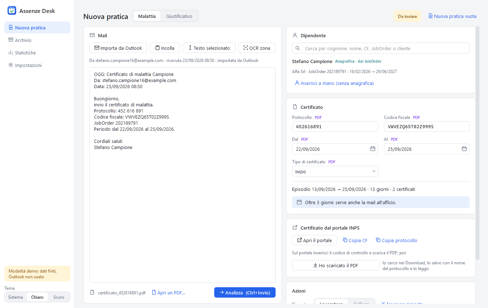
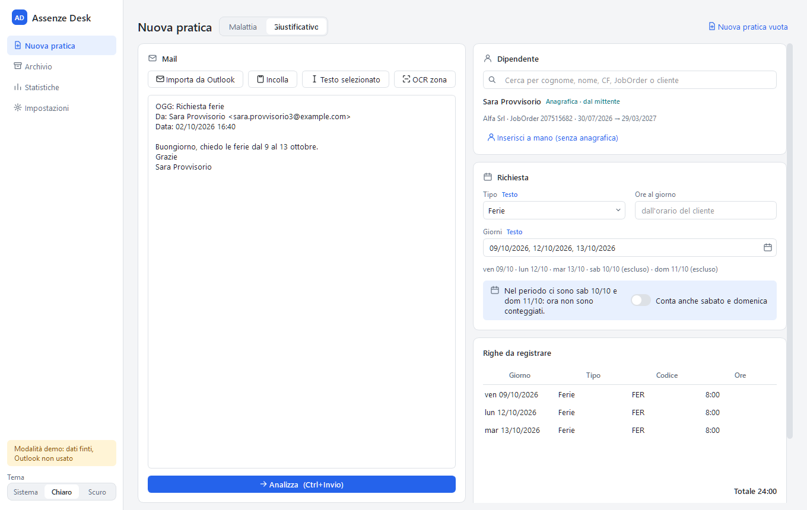
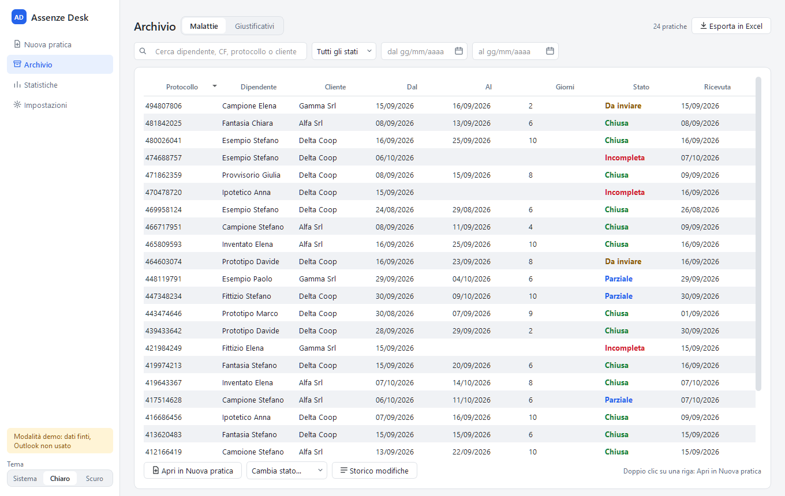
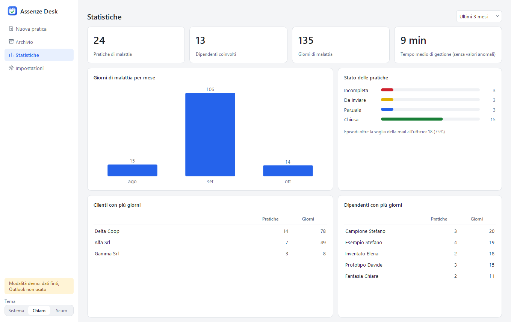
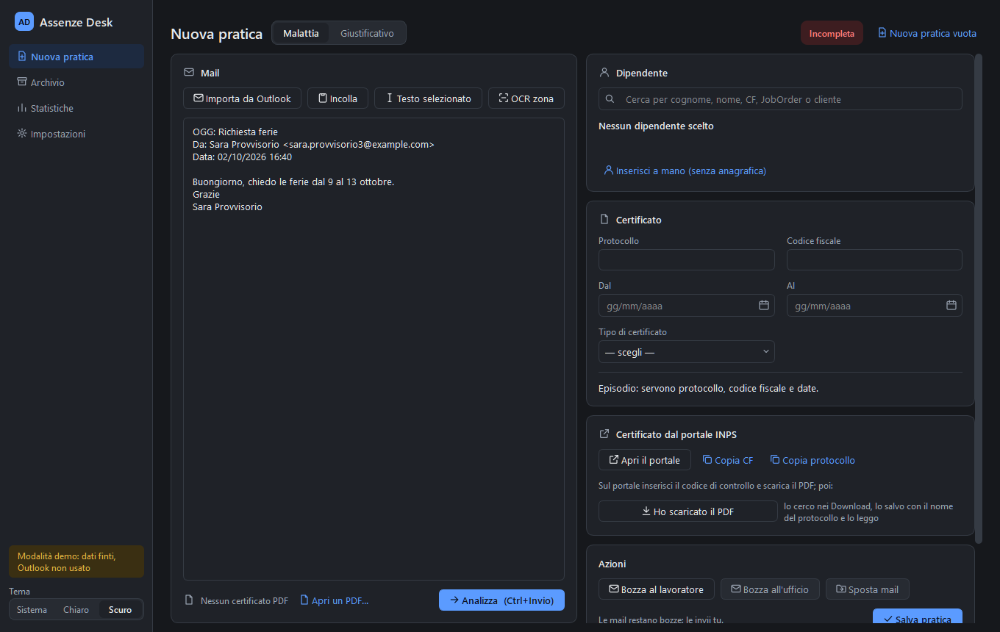

# Assenze Desk

[](https://github.com/giuseppecorso/assenze-desk/actions/workflows/ci.yml)

Applicazione desktop per Windows che gestisce malattie e richieste di
ferie e permessi a partire dalle mail. Legge i dati con regole testate,
prepara le bozze di risposta e tiene un archivio locale.
Le mail restano sempre bozze: il programma non invia niente da solo.



## Il problema

In un ufficio del personale arrivano ogni giorno mail di malattia con il
certificato INPS e richieste di ferie e permessi scritte in modo libero
("chiedo le ferie dal 9 al 13 ottobre", "esco alle 16 anziché alle 18").
Per ogni mail bisogna:
- copiare protocollo, codice fiscale e date;
- trovare il dipendente;
- capire se il certificato continua una malattia precedente;
- rispondere al lavoratore e, oltre i 3 giorni, avvisare l'ufficio con tutti
  i PDF;
- registrare i giustificativi giorno per giorno.

È un lavoro ripetitivo e facile da sbagliare.

Assenze Desk nasce dalla riscrittura di uno strumento personale (la v6.20).
Funzionava, ma era un unico file di oltre 14.000
righe, senza test, con valori aziendali scritti nel codice e alcuni errori
noti, verificati e poi corretti qui (elenco in [docs/BRIEF.md](docs/BRIEF.md)).
Per esempio:
- rispondeva alla mail selezionata invece che a quella importata;
- se non riusciva a leggere una data metteva quella di oggi;
- trovava "rol" dentro "controllo".

## Cosa fa

- **Nuova pratica**: una schermata con il testo della mail a sinistra e i dati
  a destra.
  - **Fonti del testo:** Outlook Classic, incolla, testo selezionato in
    un'altra finestra, OCR di una zona dello schermo.
  - **Dati letti:** protocollo, codice fiscale (con il controllo del carattere
    finale), date, dipendente dall'anagrafica Excel, tipo di certificato dal
    PDF INPS.
  - **Origine di ogni dato:** un'etichetta dice da dove viene (Testo, PDF,
    Anagrafica, Manuale, Archivio). Un campo corretto a mano non viene più
    sovrascritto e si può tornare al valore automatico. Le date si scelgono
    anche da un mini calendario.
- **Episodio di malattia**: i certificati contigui dello stesso lavoratore
  formano un episodio; oltre la soglia serve la mail all'ufficio, con i PDF di
  tutto l'episodio.
- **Giustificativi**: la richiesta scritta diventa una riga per giorno, con le
  ore dell'orario del cliente.
  - **Cosa sa leggere:** fasce orarie, orari spostati, "mattina" e
    "pomeriggio", giorni relativi ("lunedì prossimo", "il 13").
  - **Weekend:** sabato e domenica si contano solo accendendo un interruttore.
  - **Ore residue:** avviso se la richiesta supera le ore di ferie o ROL
    rimaste.
- **Assistente per il portale INPS**: apre il portale e copia CF e protocollo
  negli appunti. Poi trova il PDF scaricato e lo archivia con il nome del
  protocollo.
- **Archivio** in SQLite con filtri, storico delle modifiche, stato modificabile
  a mano ed export in Excel.
- **Statistiche**: giorni per mese, stati, classifiche e tempo medio di
  gestione senza i valori anomali.
- **Impostazioni** in un file JSON: percorsi, destinatari, template delle mail,
  tipi di giustificativo con codici e parole chiave, vocabolario dei permessi.
  Niente è scritto nel codice.
- **Modalità demo** con dati finti generati al momento: tutta l'app si prova
  senza Outlook e senza dati reali.

| Giustificativo | Archivio |
|---|---|
|  |  |
| **Statistiche** | **Tema scuro** |
|  |  |

Tutte le immagini vengono dalla modalità demo: nomi, codici fiscali e
protocolli sono inventati.

## Provarlo

**Senza installare Python:** scarica lo zip per Windows dalla pagina
[Releases](https://github.com/giuseppecorso/assenze-desk/releases), estrai la
cartella e fai doppio clic su `Installa.cmd`: l'app si installa per il solo
utente (senza permessi di amministratore) con l'icona sul Desktop e nel menu
Start. Per la demo senza installare: `AssenzeDesk.exe --demo` dal prompt dei
comandi nella cartella estratta.

**Dal codice:** servono Windows e Python 3.14.

```powershell
git clone https://github.com/giuseppecorso/assenze-desk.git
cd assenze-desk
py -3.14 -m venv .venv
.\.venv\Scripts\Activate.ps1
pip install -e .
python -m assenze_desk --demo
```

La modalità demo lavora in una cartella temporanea, cancellata alla chiusura.
Senza `--demo` i dati stanno in `%LOCALAPPDATA%\AssenzeDesk`.

Facoltativi:
- Outlook Classic per importare le mail; in alternativa le bozze si aprono
  con il programma di posta predefinito;
- [Tesseract](https://github.com/UB-Mannheim/tesseract/wiki) con la lingua
  italiana per l'OCR.

Per lo sviluppo: `pip install -e ".[dev]"`, poi `pytest` e `ruff check`.
La versione senza Python si crea con `pip install -e ".[exe]"` e
`python scripts/crea_eseguibile.py`; con un tag `v*` la crea la CI, insieme
alla bozza della release.

## Architettura

```text
src/assenze_desk/
  core/      regole pure: lettura di testo, date, permessi, certificato,
             episodio, stato, dipendente, template, statistiche
  storage/   archivio SQLite, anagrafica da Excel, export Excel
  adapters/  Outlook Classic, mailto, PDF, OCR, testo selezionato, portale INPS
  gui/       PySide6: tema, componenti, una schermata per modulo
  demo/      generatore di dati finti e posta finta
  servizi.py collega schermate, archivio, anagrafica e posta
  config.py  impostazioni in JSON
```

Le scelte principali:
- **Il core è puro.** Non importa Qt, Outlook o librerie di file, non legge
  file e non legge l'orologio: la data di riferimento arriva sempre come
  argomento. Così ogni regola si testa in millisecondi, anche nella CI su
  Linux. Un test ([tests/test_architettura.py](tests/test_architettura.py))
  fa rispettare la regola: vieta gli import di I/O nel core, i moduli oltre
  600 righe e `hasattr(self, ...)`.
- **L'interfaccia è sottile.** I widget mostrano lo stato dei campi calcolato
  dal core (valore, origine, avviso). L'analisi parte solo quando lo decide
  l'utente e nessuna finestra si apre da sola.
- **Meglio vuoto che sbagliato.** Quando un dato è ambiguo il campo resta vuoto
  con un avviso, invece di indovinare.
- **Regole, non un modello AI**, per leggere le mail: i testi contengono dati
  sanitari che non devono uscire dal PC, e le regole danno sempre lo stesso
  risultato e si possono testare.

Ogni scelta, con le alternative scartate, è in
[docs/DECISIONI.md](docs/DECISIONI.md) (50 decisioni).

## Regole collegate ai test

| Regola | Test |
|---|---|
| Protocollo anche con spazi o trattini, mai uguale al JobOrder | [test_identificativi.py](tests/test_identificativi.py) |
| Data non leggibile = vuota, mai la data di oggi; anno mancante = il più vicino alla mail | [test_date.py](tests/test_date.py) |
| Codice fiscale con il carattere di controllo sbagliato scartato | [test_codice_fiscale.py](tests/test_codice_fiscale.py) |
| Parole chiave a parola intera: "rol" non è dentro "controllo" | [test_giustificativi.py](tests/test_giustificativi.py) |
| "2 ore e mezza", fasce orarie, orari spostati, mattina e pomeriggio | [test_ore.py](tests/test_ore.py), [test_permessi.py](tests/test_permessi.py) |
| Episodio: certificati contigui o sovrapposti dello stesso CF | [test_episodio.py](tests/test_episodio.py) |
| Stato: Incompleta → Da inviare → Parziale → Chiusa; lo stato a mano resta | [test_stato.py](tests/test_stato.py) |
| Dipendente: JobOrder, mittente, CF, nomi; con più candidati il JobOrder attivo | [test_dipendenti.py](tests/test_dipendenti.py) |
| La risposta va alla mail importata anche se in Outlook ne è selezionata un'altra | [test_outlook.py](tests/test_outlook.py) |
| Template: dati con escape nell'HTML, segnaposti mancanti visibili | [test_template.py](tests/test_template.py) |
| Un campo scritto a mano non viene sovrascritto dall'analisi | [test_campi.py](tests/test_campi.py), [test_gui_nuova_pratica.py](tests/test_gui_nuova_pratica.py) |
| L'analisi non parte mentre si scrive; nessuna finestra si apre da sola | [test_gui_nuova_pratica.py](tests/test_gui_nuova_pratica.py) |
| Tempo medio senza i valori anomali (oltre media + 10 minuti) | [test_statistiche.py](tests/test_statistiche.py) |
| Codice fiscale sempre mascherato nei log | [test_registro.py](tests/test_registro.py) |

In tutto oltre 800 test, copertura del 98%, eseguiti a ogni push dalla CI
(Ruff e pytest, anche quelli dell'interfaccia, senza schermo).

## Privacy

- I dati restano sul PC: niente servizi esterni, niente invii automatici.
- Il codice fiscale è mascherato nei log e nello storico.
- Un controllo automatico blocca ogni commit che contiene dati reali:
  - termini di un elenco locale escluso da git;
  - email non di esempio;
  - percorsi personali;
  - file Excel o mail.

  Il controllo gira anche nella CI ([scripts/check_privacy.py](scripts/check_privacy.py)).
  Prima della pubblicazione è stato eseguito su tutta la cronologia.
- Nel repo e nei test ci sono solo dati generati: CF con luogo di nascita
  inesistente (Z999), email `@example.com`, clienti di fantasia.

## Sviluppato con l'AI

L'idea del progetto è dell'autore, che ne ha definito requisiti e regole e ha
preso le decisioni. Lo sviluppo è stato assistito dall'AI
([Claude Code](https://claude.com/claude-code)).

## Limiti

- **Funziona solo su Windows.** L'import da Outlook richiede Outlook Classic,
  non il nuovo Outlook; senza Outlook le bozze si aprono con il programma di
  posta predefinito.
- **Lingua:** le regole leggono mail in italiano.
- **Certificato INPS:** si legge il PDF scaricato dal portale. Se il formato
  cambia, vanno aggiornate le etichette.
- **OCR:** serve Tesseract installato e il testo letto va sempre controllato.
- **Un solo utente:** l'archivio sta sul PC, non è condiviso in rete.
- **Le regole coprono i modi più comuni** di scrivere una richiesta. Quando non
  sono sicure lasciano il campo vuoto: l'ultima parola resta all'utente.

## Licenza

[MIT](LICENSE)
