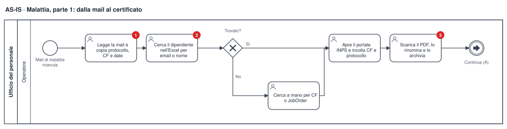
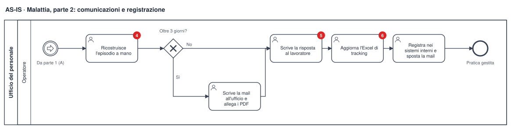
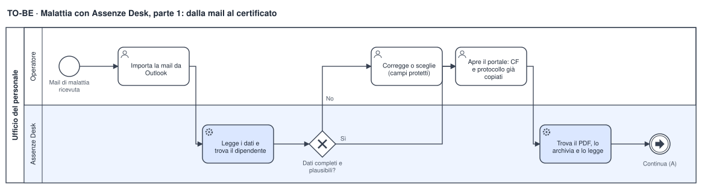
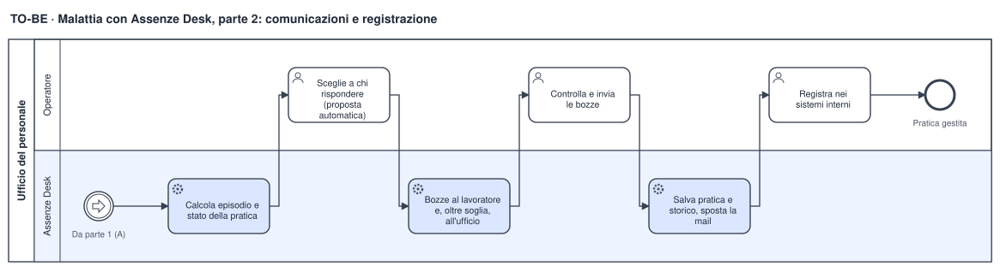
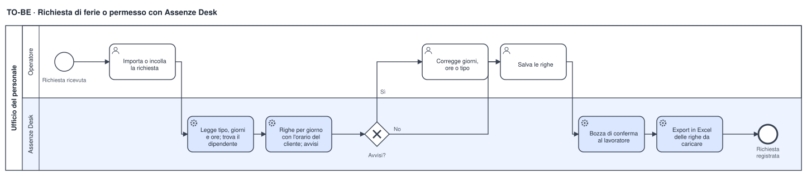

# Analisi funzionale — Assenze Desk

| | |
|---|---|
| Prodotto | Assenze Desk 1.2.0 |
| Autore | Giuseppe Corso |
| Stato | Rilasciato; documento aggiornato al 12/10/2026 |
| Allegati | Schemi BPMN 2.0 in [`docs/analisi/`](analisi/) (SVG e `.bpmn` modificabili) |

## 1. Scopo del documento

Descrive il problema, il processo prima e dopo il prodotto, i requisiti e le
regole che il software implementa. Ogni requisito è collegato al test che lo
verifica: il documento resta allineato al codice.

## 2. Contesto e problema

In un ufficio del personale le assenze arrivano per mail: certificati di
malattia (con il protocollo dell'attestato INPS) e richieste di ferie o
permessi scritte in modo libero. Per ogni mail l'operatore deve:

- riconoscere il lavoratore nell'anagrafica, anche quando scrive da un
  indirizzo diverso da quello registrato;
- leggere protocollo, codice fiscale e periodo, oppure giorni e ore;
- scaricare il certificato dal portale INPS e archiviarlo;
- capire se il certificato prolunga un episodio già aperto, perché oltre una
  soglia di giorni va avvisato un altro ufficio con tutti i certificati;
- rispondere al lavoratore, con il cliente in copia;
- registrare la pratica e trasformare le richieste in righe per giorno, con le
  ore dell'orario del cliente.

Il lavoro è ripetitivo, avviene molte volte al giorno ed è soggetto a errori di
trascrizione. Uno strumento precedente (v6.20) automatizzava una parte del
lavoro, ma era un unico file senza test, con dati aziendali nel codice e alcuni
errori noti (sezione 6).

## 3. Obiettivi e indicatori

| Obiettivo | Indicatore | Risultato |
|---|---|---|
| Ridurre il tempo di gestione | Tempo per pratica rispetto all'inserimento manuale | **−70% circa**, misurato dall'autore sull'uso reale |
| Eliminare la ricopiatura dei dati | Campi compilati senza digitazione (protocollo, CF, date, dipendente) | Tutti, con l'origine di ogni dato visibile |
| Evitare risposte al destinatario sbagliato | Risposta creata sulla mail gestita | Garantito dall'identificativo della mail (test) |
| Non perdere dati | Copie di sicurezza e ripristino | Copia giornaliera, ultime 14, ripristino automatico |
| Tracciabilità | Storico delle azioni per pratica | Ogni salvataggio e modifica registrati |
| Privacy | Dati personali fuori dal PC | Nessuno: nessun servizio esterno |

Il tempo medio di gestione si legge nelle Statistiche dell'app, calcolato
escludendo i valori anomali (pratiche lasciate aperte).

## 4. Attori

| Attore | Ruolo nel processo |
|---|---|
| Operatore dell'ufficio del personale | Utente unico dell'app: controlla, corregge, decide e invia |
| Lavoratore | Invia certificato o richiesta; riceve la conferma |
| Collega | A volte inoltra il certificato al posto del lavoratore |
| Cliente (azienda utilizzatrice) | In copia nella risposta (lista di distribuzione) |
| Ufficio che gestisce le malattie lunghe | Riceve la mail con i certificati quando l'episodio supera la soglia |
| Portale INPS | Fornisce il PDF dell'attestato (consultazione manuale) |
| Outlook, anagrafica Excel | Fonti delle mail e dei dati dei dipendenti |

## 5. Ambito

**Dentro:** lettura delle mail (Outlook Classic, testo incollato, testo
selezionato, OCR), riconoscimento del dipendente, certificato INPS,
episodio e stato della pratica, bozze delle risposte, righe dei giustificativi,
archivio con storico, statistiche, export in Excel, import dei dati della
versione precedente, copie di sicurezza.

**Fuori:** invio automatico delle mail (restano bozze), compilazione del
codice di controllo del portale INPS, inserimento nei sistemi interni
dell'azienda, gestione di più utenti contemporanei.

## 6. Processo AS-IS (prima)

Criticità (i numeri rossi negli schemi):

| N. | Criticità | Effetto |
|---|---|---|
| 1 | Protocollo, CF e date ricopiati a mano | Errori di trascrizione; protocolli con spazi o trattini non riconosciuti |
| 2 | Dipendente cercato solo per email o nome | Con un indirizzo personale nuovo la ricerca fallisce e si rifà a mano ogni volta |
| 3 | PDF rinominati e archiviati a mano | Nomi non uniformi, certificati difficili da ritrovare |
| 4 | Episodio ricostruito contando i giorni a mano | Rischio di non avvisare l'ufficio oltre la soglia |
| 5 | Risposta creata sulla mail selezionata in quel momento | Se nel frattempo se ne seleziona un'altra, la risposta parte verso la persona sbagliata |
| 6 | Excel di tracking riscritto per intero a ogni modifica | Lentezza, nessuno storico, rischio di file rovinati |

Altri problemi noti dello strumento precedente: data non leggibile sostituita
dalla data di oggi, parole chiave trovate dentro altre parole ("rol" dentro
"controllo"), ore con minuti lette male, analisi che partiva mentre si
scriveva, errori ignorati in silenzio. Tutti corretti e coperti da test.

## 7. Processo TO-BE (dopo)

Le attività su sfondo blu le svolge Assenze Desk; all'operatore restano le
verifiche e le decisioni.

| Criticità AS-IS | Come la risolve il TO-BE |
|---|---|
| 1 Ricopiatura | Estrazione a regole dal testo e dal PDF; ogni campo mostra la sua origine (Testo, PDF, Anagrafica, Manuale, Archivio) |
| 2 Dipendente non trovato | Ricerca per JobOrder, mittente, CF e nome; gli indirizzi nuovi si ricordano al salvataggio |
| 3 PDF non uniformi | Il PDF scaricato si trova da solo nei Download e si archivia come `<protocollo>.pdf` |
| 4 Episodio a mano | Episodio e stato calcolati; avviso quando serve la mail all'ufficio |
| 5 Risposta sbagliata | La bozza risponde sempre alla mail importata |
| 6 Excel riscritto | Archivio SQLite: ogni modifica tocca una riga, con storico |

## 8. Requisiti funzionali

Priorità MoSCoW: M = must, S = should, C = could.

| ID | Requisito | Pr. | Verifica |
|---|---|---|---|
| RF-01 | Importare la mail selezionata in Outlook Classic, con mittente, data e allegati | M | [test_outlook.py](../tests/test_outlook.py) |
| RF-02 | Leggere testo incollato, testo selezionato in un'altra finestra e una zona dello schermo (OCR) | S | [test_ocr.py](../tests/test_ocr.py), [test_gui_integrazioni.py](../tests/test_gui_integrazioni.py) |
| RF-03 | Estrarre protocollo, codice fiscale e periodo, segnalando i dati incerti | M | [test_identificativi.py](../tests/test_identificativi.py), [test_codice_fiscale.py](../tests/test_codice_fiscale.py), [test_date.py](../tests/test_date.py), [test_analisi.py](../tests/test_analisi.py) |
| RF-04 | Riconoscere il dipendente (JobOrder, mittente, CF, nome) e proporre i candidati quando è incerto | M | [test_dipendenti.py](../tests/test_dipendenti.py) |
| RF-05 | Ricordare l'indirizzo da cui scrive un dipendente quando non è quello in anagrafica | S | [test_dipendenti.py](../tests/test_dipendenti.py), [test_servizi.py](../tests/test_servizi.py) |
| RF-06 | Correggere i dati di un dipendente senza modificare il file Excel | S | [test_correzioni.py](../tests/test_correzioni.py), [test_gui_nuova_pratica.py](../tests/test_gui_nuova_pratica.py) |
| RF-07 | Proteggere i campi scritti a mano dalle analisi successive, con ritorno al valore automatico | M | [test_campi.py](../tests/test_campi.py) |
| RF-08 | Leggere il certificato PDF INPS e archiviarlo con il nome del protocollo | M | [test_pdf.py](../tests/test_pdf.py), [test_certificato.py](../tests/test_certificato.py), [test_inps.py](../tests/test_inps.py) |
| RF-09 | Calcolare episodio e stato della pratica; avvisare quando serve la mail all'ufficio | M | [test_episodio.py](../tests/test_episodio.py), [test_stato.py](../tests/test_stato.py) |
| RF-10 | Preparare le bozze: al lavoratore (cliente in copia) o al collega, e all'ufficio con i PDF dell'episodio | M | [test_risposte.py](../tests/test_risposte.py), [test_bozze.py](../tests/test_bozze.py), [test_template.py](../tests/test_template.py) |
| RF-11 | Trasformare una richiesta di ferie o permesso in righe per giorno con l'orario del cliente | M | [test_permessi.py](../tests/test_permessi.py), [test_righe.py](../tests/test_righe.py), [test_turni.py](../tests/test_turni.py) |
| RF-12 | Avvisare se la richiesta supera le ore residue | C | [test_righe.py](../tests/test_righe.py) |
| RF-13 | Archivio con filtri, storico, stato modificabile a mano ed eliminazione con conferma | M | [test_archivio.py](../tests/test_archivio.py), [test_gui_sezioni.py](../tests/test_gui_sezioni.py) |
| RF-14 | Export in Excel di pratiche e righe | S | [test_export.py](../tests/test_export.py) |
| RF-15 | Statistiche: giorni per mese, stati, tempo medio senza valori anomali | C | [test_statistiche.py](../tests/test_statistiche.py) |
| RF-16 | Import dei dati della versione precedente senza doppioni | S | [test_import_v620.py](../tests/test_import_v620.py) |
| RF-17 | Copia di sicurezza giornaliera e ripristino se l'archivio è danneggiato | M | [test_backup.py](../tests/test_backup.py), [test_servizi.py](../tests/test_servizi.py) |
| RF-18 | Impostazioni modificabili senza toccare il codice (destinatari, template, tipi, regole) | M | [test_config.py](../tests/test_config.py) |

## 9. Requisiti non funzionali

| ID | Requisito | Come è garantito |
|---|---|---|
| RNF-01 Privacy | Nessun dato personale lascia il PC | Nessuna connessione di rete nel codice; dettagli in [sicurezza.md](sicurezza.md) |
| RNF-02 Controllo umano | Nessuna mail inviata in automatico | Le mail sono sempre bozze da controllare |
| RNF-03 Affidabilità | Nessun errore ignorato in silenzio; nessun dato perso | Errori mostrati e registrati; copie di sicurezza |
| RNF-04 Tracciabilità | Ogni modifica registrata | Storico nell'archivio; log con CF mascherato ([test_registro.py](../tests/test_registro.py)) |
| RNF-05 Usabilità | Nessuna azione a sorpresa: analisi solo quando l'utente la chiede, nessuna finestra che si apre da sola | [test_gui_nuova_pratica.py](../tests/test_gui_nuova_pratica.py) |
| RNF-06 Installazione | Senza Python e senza permessi di amministratore | Eseguibile con `Installa.cmd` per il solo utente |
| RNF-07 Manutenibilità | Regole di business separate da interfaccia e I/O | Core puro verificato da [test_architettura.py](../tests/test_architettura.py); CI a ogni modifica |
| RNF-08 Prova senza dati reali | Tutto il prodotto si prova con dati finti | Modalità demo ([test_ambiente_demo.py](../tests/test_ambiente_demo.py)) |

## 10. User story e criteri di accettazione

**US-01 — Riconoscere il dipendente da un indirizzo nuovo.**
Come operatore, voglio che il lavoratore venga riconosciuto anche quando scrive
da una mail personale, per non cercarlo a mano ogni volta.
- *Dato* un lavoratore con un'altra email in anagrafica, *quando* scrive da un
  indirizzo nuovo con il suo CF nel testo, *allora* l'app lo propone dal CF.
- *Quando* salvo la pratica, *allora* l'app ricorda l'indirizzo e me lo dice.
- *Quando* arriva una seconda mail dallo stesso indirizzo senza CF, *allora*
  lo riconosce dal mittente.
- Le mail dei colleghi (domini interni) non si ricordano.

Test: `test_mail_da_un_indirizzo_nuovo_viene_ricordata`, `test_email_da_ricordare`.

**US-02 — Non perdere una correzione manuale.**
Come operatore, voglio che un dato che correggo non venga riscritto da una
nuova analisi, per potermi fidare di quello che vedo.
- *Dato* un campo corretto a mano, *quando* rilancio l'analisi, *allora* il
  campo resta il mio e mostra "Manuale", con il valore automatico a fianco.

Test: `test_un_campo_scritto_a_mano_resta_dopo_una_nuova_analisi`.

**US-03 — Rispondere alla mail giusta.**
Come operatore, voglio che la risposta parta sempre dalla mail che sto
gestendo, anche se in Outlook ne ho selezionata un'altra.
- *Dato* che ho importato la mail A, *quando* seleziono la mail B e creo la
  bozza, *allora* la bozza risponde ad A.

Test: [test_outlook.py](../tests/test_outlook.py).

**US-04 — Sapere quando avvisare l'ufficio.**
Come operatore, voglio sapere se un certificato prolunga un episodio oltre la
soglia, per mandare all'ufficio tutti i certificati dell'episodio.
- *Dati* certificati contigui o sovrapposti dello stesso CF, *allora* formano
  un episodio; oltre la soglia la pratica chiede la mail all'ufficio e la
  bozza allega i PDF di tutto l'episodio.

Test: [test_episodio.py](../tests/test_episodio.py), [test_stato.py](../tests/test_stato.py).

**US-05 — Trasformare una richiesta scritta in righe.**
Come operatore, voglio che "dal 9 al 13 ottobre" diventi una riga per giorno
con le ore del cliente, senza contare il weekend se non lo decido io.
- Le fasce orarie, la mattina e il pomeriggio, i giorni relativi
  ("lunedì prossimo") sono letti; il weekend si aggiunge solo con l'interruttore.

Test: [test_permessi.py](../tests/test_permessi.py), [test_righe.py](../tests/test_righe.py).

**US-06 — Ritrovare i dati dopo un guasto.**
Come operatore, voglio che l'archivio si recuperi se il file si danneggia.
- *Dato* un archivio danneggiato, *quando* apro l'app, *allora* il file viene
  messo da parte e si riprende l'ultima copia, con un avviso che ne dice la data.

Test: `test_archivio_danneggiato_si_ripristina_dall_ultima_copia`.

## 11. Regole di business

Le regole principali, ognuna con il suo test, sono nella tabella
["Regole collegate ai test"](../README.md#regole-collegate-ai-test) del README.
In più:

| Regola | Test |
|---|---|
| Un indirizzo si ricorda solo se esterno, diverso da quello in anagrafica e non già ricordato per lo stesso CF | [test_dipendenti.py](../tests/test_dipendenti.py) |
| Le correzioni dell'anagrafica valgono sopra l'Excel; CF e JobOrder non si correggono | [test_correzioni.py](../tests/test_correzioni.py) |
| Il protocollo scritto a mano si pulisce solo a fine scrittura e solo se resta un numero | [test_identificativi.py](../tests/test_identificativi.py) |
| Copie di sicurezza: una al giorno, le ultime 14, il file danneggiato non si cancella mai | [test_backup.py](../tests/test_backup.py) |

## 12. Dati gestiti

| Entità | Contenuto | Dove |
|---|---|---|
| Pratica di malattia | Protocollo (chiave), CF, dipendente, JobOrder, cliente, periodo, giorni dell'episodio, mail inviate, stato manuale, tempo di gestione | Archivio SQLite |
| Riga di giustificativo | Dipendente, giorno, tipo, codice, minuti, esportata | Archivio SQLite |
| Storico | Data, azione, protocollo, dettaglio (CF mascherato) | Archivio SQLite |
| Indirizzo ricordato | Email, CF | Archivio SQLite |
| Correzione dell'anagrafica | CF, JobOrder, campo, valore | Archivio SQLite |
| Dipendente | CF, cognome, nome, email, JobOrder, cliente, periodo, lista in copia | Anagrafica Excel (solo lettura) |
| Certificato | PDF dell'attestato | Cartella dei certificati |
| Impostazioni | Percorsi, destinatari, template, regole | File JSON |

Lo stato della pratica non si salva: si calcola ogni volta dalle regole, così
cambiare una regola aggiorna anche le pratiche esistenti (resta solo lo stato
impostato a mano).

## 13. Rischi e mitigazioni

| Rischio | Mitigazione |
|---|---|
| Dato estratto sbagliato | Origine visibile, avvisi sui dati incerti, campi correggibili, mail sempre in bozza |
| Dipendente omonimo | Con più candidati sceglie l'utente; il JobOrder attivo nel periodo ha la precedenza |
| Archivio danneggiato o PC guasto | Copie giornaliere, anche in una cartella esterna al PC; ripristino automatico |
| Cambio del formato del certificato INPS | Lettura a regole testata su PDF finti; se un dato manca, avviso e inserimento a mano |
| Dati personali esposti | Nessun servizio esterno; log con CF mascherato; repository con soli dati finti e controllo automatico prima di ogni modifica |

## 14. Evoluzioni possibili

- Più utenti sullo stesso archivio (oggi un utente per volta).
- Cifratura dell'archivio e delle copie.
- Conservazione con cancellazione automatica dopo un periodo stabilito.
- Collegamento diretto ai sistemi interni, dove esiste un'interfaccia
  documentata, al posto dell'inserimento manuale.

## 15. Schemi BPMN

| Schema | Immagine | BPMN 2.0 |
|---|---|---|
| AS-IS malattia, parte 1 | [SVG](analisi/as-is-malattia-1.svg) | [as-is-malattia-1.bpmn](analisi/as-is-malattia-1.bpmn) |
| AS-IS malattia, parte 2 | [SVG](analisi/as-is-malattia-2.svg) | [as-is-malattia-2.bpmn](analisi/as-is-malattia-2.bpmn) |
| TO-BE malattia, parte 1 | [SVG](analisi/to-be-malattia-1.svg) | [to-be-malattia-1.bpmn](analisi/to-be-malattia-1.bpmn) |
| TO-BE malattia, parte 2 | [SVG](analisi/to-be-malattia-2.svg) | [to-be-malattia-2.bpmn](analisi/to-be-malattia-2.bpmn) |
| TO-BE giustificativo | [SVG](analisi/to-be-giustificativo.svg) | [to-be-giustificativo.bpmn](analisi/to-be-giustificativo.bpmn) |

I file `.bpmn` si aprono con [bpmn.io](https://demo.bpmn.io) o Camunda Modeler.
Schemi e file si rigenerano con `python scripts/genera_bpmn.py`.
